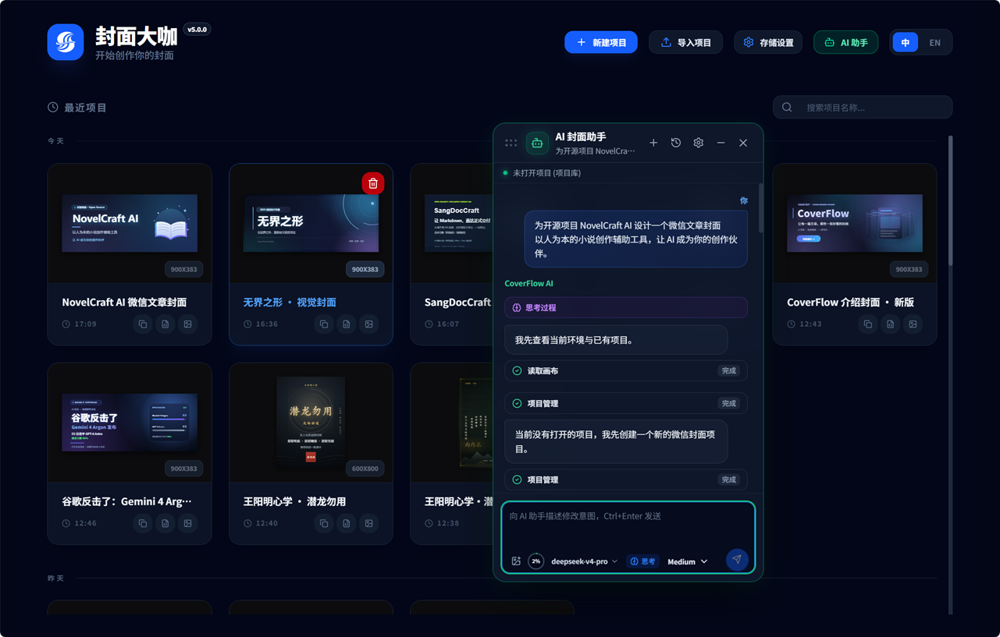

CoverFlow - 专业 SVG 文章封面设计器
=====================================

面向多平台文章封面图的 Web 设计工具。基于 SVG 资源库与图层系统，提供可配置画布、快速排版、背景生成与项目保存导出能力，适合日常内容运营与设计协作。



使用方式
--------

- 在线使用：https://sangyuxiaowu.github.io/CoverFlow/
- 安装为桌面/应用：在浏览器菜单中选择“安装应用”（PWA）
- 前往 [Releases](https://github.com/sangyuxiaowu/CoverFlow/releases) 下载桌面版安装包：
	- 打开最新版本（Latest）
	- 选择与你的系统匹配的安装包（Windows/macOS/Linux）

核心功能
--------

### 存储方式

- 本地存储：使用 LocalStorage 保存项目数据，适合单用户使用
- 本地文件系统：利用 File System Access API 直接读写用户文件（需 HTTPS 环境）

### 画布系统

- 多比例画布：内置微信文章封面比例（2.35:1、1:1），同时可自定义
- 画布控制：缩放、滚动平移、重置缩放

### SVG / PNG 资源管理

- 分类资源库：内置基础图形、装饰元素、可加载用户自定义 SVG / PNG 资源文件夹
- 搜索与过滤：按名称关键词筛选

### 装饰库

- 内置装饰库：提供一批可直接添加到画布的预置装饰
- 自定义装饰：支持 CSS 声明或静态 HTML（含内联样式和作用域化 `<style>`），自动识别类型，也可手动切换
- 装饰检查器：编辑源码、HTML 节点文本与内联样式；自动识别 CSS 变量并生成对应控件，颜色变量使用色板，不再依赖固定的图层主色
- 变量拾色器：支持 HEX（含透明度）、RGB/RGBA、HSL/HSLA、OKLCH 与 CSS 命名颜色；提供透明度滑块、通道输入和格式切换。色板交互使用 sRGB，OKLCH 可通过数值编辑；屏幕取色需浏览器支持 EyeDropper API，不支持时按钮禁用
- 装饰模板：可将当前画布中的多个图层保存为装饰模板，便于复用整套角标、边框、排版组合

### 图标库

- 集成 Font Awesome 图标库（需手动加载数据）
- 启用方式：从 Font Awesome 下载 `icon-families.json` 与 `categories.yml`，在图标库面板上传后即可使用
- 支持搜索与分类浏览，一键添加到画布生成图层

### 图层编辑系统

- 图层面板：列表展示全部图层
- 图层操作：
	- 位置调整（XY 拖拽 / 精确数值输入）
	- 缩放（等比 / 非等比，拖拽 / 数值控制）
	- 旋转（自由旋转 / 15 度步进）
	- 顺序调整（拖拽排序）
	- 显示 / 隐藏 / 锁定
- 装饰图层：支持颜色联动、自定义宽高与样式内容编辑
- 文本增强：文字渐变
- 历史操作：撤销 / 重做

### 背景系统

- 纯色 / 线性渐变 / 图片 / 自定义 CSS 背景，CSS 支持多层渐变、背景纹理和自定义变量
- 叠加纹理：条纹、网格、波点
- 背景图片：上传或链接
- 预置背景：常用渐变方案与自定义预设

自定义背景填写 CSS 声明（不含选择器），仅支持 `background` 相关属性和 CSS 变量。装饰 HTML 最多 24000 字符、300 个元素，CSS 最多 6000 字符。两者都不执行脚本，不支持外部资源、CSS at-rule、动画、固定定位和视口单位；使用百分比或像素适配画布。HTML 图片仅接受嵌入的 PNG/JPEG/WebP/GIF，普通图片资源仍使用图片图层。HTML 源码保存在项目与装饰库中，清洗和样式作用域只在渲染时生成。

### 导出与分享

- 图片导出：项目列表快速导出仅支持 PNG，编辑页面可导出 PNG/JPEG/WEBP 格式，并支持自定义分辨率和压缩质量
- 项目文件格式：JSON 保存项目状态
	- 图层信息、位置、样式
	- SVG 和 图像资源

### 项目管理

- 本地项目列表：浏览最近项目
- 项目导入 / 导出：支持 cfj 后缀的 JSON 格式项目文件，便于备份与分享

### AI 助手

- 全局 AI 入口，项目库和编辑页均可使用；参考 SangDocCraft 的 OpenAI 兼容接口和工具调用方式
- 项目搜索（分页查询存储）、新建、打开、重命名、复制、确认删除和保存
- 创建文字、SVG、图片和 CSS/HTML 装饰图层；批量修改内容、位置、大小、旋转、透明度、文字渐变/阴影、显隐和锁定
- 图层复制、删除、组合/拆组、置顶/置底、画布对齐和等间距分布；调整画布和背景
- 修改进入编辑历史，可使用现有撤销/重做；工具记录可展开查看结果，支持停止执行
- 可拖动、缩放、最小化和最大化的浮窗，记忆位置与尺寸；聊天中按接入点分组切换模型
- 多个接入点和各自的模型列表，独立配置上下文容量、输出上限、思考参数和视觉输入能力
- 视觉模型支持粘贴或上传图片、预览当前画布；图像以 WebP 压缩且长边不超过 600px
- 会话独立保存，支持新建、切换、重命名和确认删除；刷新恢复当前会话及正文、思考、工具记录和图片附件

在 AI 浮窗的模型设置中维护多个接入点，填写 API 基础地址、模型列表和 API Key，支持 OpenAI、DeepSeek、Ollama 预设与自定义 Responses 兼容服务。请求使用官方 OpenAI SDK 的 Responses API，模型必须支持函数工具调用。基础地址示例：OpenAI 为 `https://api.openai.com/v1`，DeepSeek 为 `https://api.deepseek.com`，Ollama 为 `http://localhost:11434/v1`。按模型配置支持的思考档位，通过 `reasoning.effort` 统一控制，无需设置思考协议。

每个模型可配置上下文窗口 Token 与最大输出 Token；前者用于客户端预算和占用比例，不会改变服务端容量。Ollama 的实际上下文还需在服务端配置 `num_ctx`。输入区展示上下文估算、占用百分比和预留输出预算，展开后可查看上次输入实测、本次操作及会话累计用量、输入/输出、缓存命中、思考 Token 和请求次数。缓存与思考计数是输入/输出的子集，不重复累加；工具循环的每次请求均计入消耗。下一次上下文估算使用 UTF-8 字节启发式，并以同模型的最近实测输入校准，不是服务端精确计数。中断或未返回 usage 的请求标记为统计不完整，不伪造为零。

浏览器模式下，模型、连接、会话、图片二进制和 AI 界面状态分别保存在 IndexedDB。文件模式下，存储目录（Tauri 为当前项目旁）的 `chat/config.json` 保存配置与加密 Key，`chat/ui.json` 保存窗口与当前会话状态，`chat/sessions/<会话ID>.json` 保存会话记录，`chat/images/<会话ID>/` 保存独立 WebP 附件；删除会话会同时删除其图片，不嵌入封面项目文件。切换存储模式不会自动混合两边记录。

API Key 参考 SangDocCraft 使用 AES-GCM 256 位加密，配合随机 IV 和保存在本机 IndexedDB 中、不可导出的 CryptoKey，刷新后自动恢复。文件中的密文仅能由当前浏览器/设备解密，不能将 `chat` 文件夹当作跨设备密钥备份。浏览器配置和密文同事务提交，文件配置以单文件提交。清除站点数据会删除本机主密钥；该方案不防御同源恶意脚本或浏览器环境被攻破。浏览器直连端点，服务需允许 CORS；线上 HTTPS 页面不能访问普通 HTTP 服务。

发送消息意味着允许将提示词及工具读取的项目标题、画布、图层内容发送到配置的服务商。视觉模型启用后，用户主动附加的图片和 AI 请求的画布预览会以压缩 WebP 发送；不会上传本地文件路径。删除项目需单独确认；AI 执行期间暂停手动编辑。停止不会撤销已完成的操作。图片工具使用现有 URL，不提供文生图服务。

架构及扩展方式见 [AI 模块说明](doc/ai-architecture.md)。

### 预设与模板

- 背景预设：保存和复用常用背景方案
- 装饰元素：保存常用单个装饰，构建个人装饰库
- 装饰模板：保存当前画布中的多图层组合，适合沉淀常用版式组件

### 剪贴板与快速添加

- 粘贴 JSON 内容：应用到当前项目，不修改项目 ID 和标题
- 粘贴文本：快速生成文本图层
- 粘贴 SVG 代码 / SVG 文件：快速生成 SVG 图层
- 粘贴图片文件：快速生成图片图层

快捷键
------

- Delete / Backspace：删除选中图层
- Arrow Keys：1px 移动
- Shift + Arrow：10px 移动
- Ctrl + J：克隆选中图层
- Ctrl + G：组合图层
- Ctrl + 上下：调整图层层级
- Ctrl + 左右：调整旋转角度
- Enter：编辑文本图层，也可以使用双击
- Ctrl + Z：撤销
- Ctrl + Y：重做
- Ctrl + S：保存项目

技术栈
------

- React 19 + TypeScript
- Vite 6
- Tauri
- tailwindcss
- html-to-image（导出）

本地开发
--------

前置要求：Node.js 18+（推荐 20+）

```bash
bun install
bun run dev
```

构建与预览：

```bash
bun run build
bun run preview
```

测试与类型检查：

```bash
bun run test
bun run typecheck
```

目录结构
--------

```
.
├─ src/                # 前端应用源码，测试与对应模块放在一起
│  ├─ assets/          # 随前端打包的图片与 Logo
│  ├─ components/      # UI 组件与面板
│  ├─ features/        # AI、背景移除等独立功能模块
│  ├─ hooks/           # 业务 Hooks
│  ├─ views/           # 落地页、项目浏览区与预览条目
│  ├─ storage/         # 存储适配器
│  ├─ utils/           # 工具函数
│  ├─ App.tsx          # 顶层视图切换与编辑状态
│  ├─ index.tsx        # React 挂载入口
│  ├─ index.css        # 全局样式
│  ├─ constants.ts     # 常量与默认配置
│  ├─ types.ts         # 类型定义
│  ├─ translations.ts  # 文案与多语言
│  └─ vite-env.d.ts    # Vite 与浏览器 API 类型声明
├─ src-tauri/          # Tauri 原生端
├─ scripts/            # 构建/同步脚本
├─ doc/                # 文档与素材
├─ public/             # PWA 资源与静态文件
├─ index.html          # Vite HTML 入口
├─ vite.config.ts      # 开发与打包配置
└─ tsconfig.json       # TypeScript 配置
```

应用源码统一位于 `src/`，`@/` 别名指向该目录。`public/` 中保留按 URL 直接访问的图标和模型文件；构建脚本、配置、文档与 Tauri 原生工程不放入前端源码目录。

许可协议
--------

AGPL-3.0-or-later

--------

资源推荐：
- [Hero Patterns](https://www.heropatterns.com/) - 免费 SVG 背景图案
- [Fluent UI Emoji](https://github.com/microsoft/fluentui-emoji) - 免费表情图标
- [SVG Repo](https://www.svgrepo.com/) - 大量免费 SVG 图标与插画
- [Font Awesome](https://fontawesome.com/) - 丰富的图标库（需手动加载数据）
- [Pixabay Vectors](https://pixabay.com/zh/vectors/) - 免费矢量图资源
- [Iconfont](https://www.iconfont.cn/) - 阿里巴巴矢量图标库