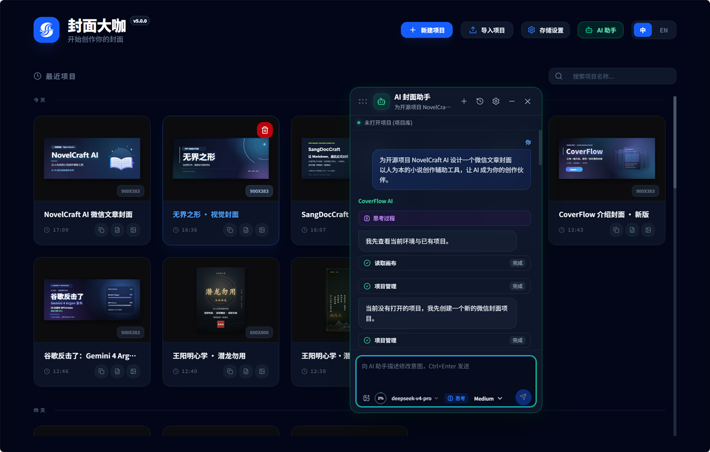
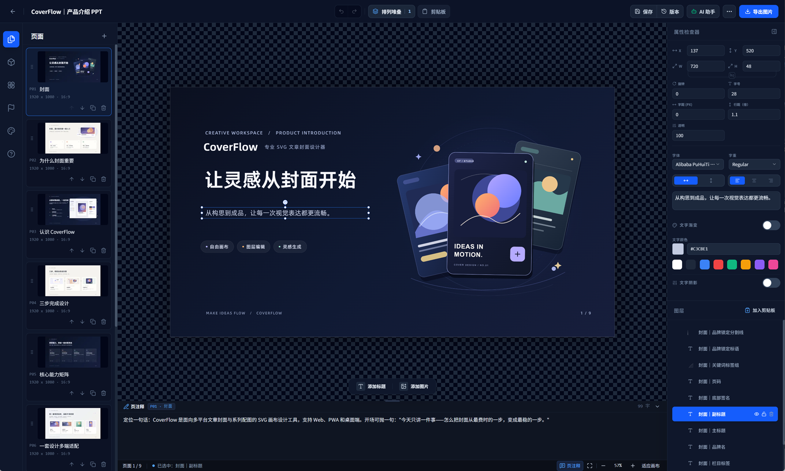

CoverFlow - 专业 SVG 文章封面设计器
=====================================

面向多平台文章封面与系列配图的设计工具，支持 Web、PWA 和桌面端。以项目组织多个独立页面，结合 SVG 资源库、图层编辑、背景设计与 AI 助手，完成从素材整理、版式制作到图片、SVG 和演示稿导出的工作流程，适合日常内容运营与设计协作。

使用方式
--------

- 在线使用：https://sangyuxiaowu.github.io/CoverFlow/
- 安装为 PWA：在支持的浏览器菜单中选择“安装应用”
- 桌面版：前往 [Releases](https://github.com/sangyuxiaowu/CoverFlow/releases)，从最新版本下载适用于 Windows、macOS 或 Linux 的安装包

新建项目后，可在左侧添加页面、设置画布和背景，再添加文字、图片或装饰图层。完成后选择导出格式；需要继续编辑或备份时，导出 `.cfjx` 项目文件。

核心功能
--------

### 项目与页面

- 一个项目包含 1-99 个页面，每页独立设置尺寸、背景和图层，可用于多平台封面、系列配图或演示稿
- 页面支持添加、重命名、复制、删除和拖动排序；可添加不显示在画布上的页注释，并从当前页开始全屏预览
- 项目库支持浏览、重命名、复制和删除；支持撤销 / 重做与独立的项目版本管理

### 保存与项目文件

- 项目支持自动保存、手动保存，以及 `.cfjx` 导入 / 导出，用于继续编辑、备份和分享
- 浏览器可使用本地存储或已授权的文件夹；文件夹模式需要支持 File System Access API 的浏览器及 HTTPS 或 localhost。权限失效时可在存储设置中重新选择原文件夹
- 在支持文件处理的浏览器中安装 PWA 并关联 `.cfjx` 后，可从系统直接打开项目；重新打开或保存时可能需要再次授权。移除项目列表记录不会删除原文件

**旧项目提醒：** 10.0.0 将移除旧格式兼容，请提前按 [旧项目兼容与转换](doc/legacy-projects.md) 处理 `.cfj` 和旧版 `.cfjx` 文件。

### 画布系统

- 多比例画布：内置微信文章封面比例（2.35:1、1:1），同时可自定义
- 画布控制：缩放、滚动平移、重置缩放
- 各页尺寸可独立调整，同一项目可同时制作不同平台比例的封面
- 预览：从当前页开始只读的全屏查看，类似 PPT 播放

### SVG / PNG 资源管理

- 分类资源库：内置基础图形、装饰元素、可加载用户自定义 SVG / PNG 资源文件夹
- 搜索与过滤：按名称关键词筛选

### 装饰库

- 内置装饰库：提供一批可直接添加到画布的预置装饰
- 自定义装饰：支持 CSS 声明或静态 HTML（含内联样式和作用域化 `<style>`），自动识别类型，也可手动切换
- 装饰检查器：编辑源码、HTML 节点文本与内联样式；自动识别 CSS 变量并生成对应控件，每个颜色变量可通过独立色板调整
- 变量拾色器：支持 HEX（含透明度）、RGB/RGBA、HSL/HSLA、OKLCH 与 CSS 命名颜色；提供透明度滑块、通道输入和格式切换。浏览器屏幕取色需要 EyeDropper API，桌面版支持应用内取色
- 装饰模板：可将当前画布中的多个图层保存为装饰模板，便于复用整套角标、边框、排版组合

### 图标库

- 集成 Font Awesome 图标库（需手动加载数据）
- 启用方式：从 Font Awesome 下载 `icon-families.json` 与 `categories.yml`，在图标库面板上传后即可使用
- 支持搜索与分类浏览，一键添加到画布生成图层

### 图层编辑系统

- 图层面板：列表展示当前页图层，页面之间独立编辑
- 图层操作：
	- 位置调整（XY 拖拽 / 精确数值输入）
	- 缩放（等比 / 非等比，拖拽 / 数值控制）
	- 旋转（自由旋转 / 15 度步进）
	- 顺序调整（拖拽排序）
	- 显示 / 隐藏 / 锁定
- 支持在画布和图层面板中多选图层，并批量移动、变换和排列
- 装饰图层：支持颜色联动、自定义宽高与样式内容编辑
- 图片图层：支持裁剪、翻转、亮度 / 对比度 / 灰度 / 模糊调整，以及圆角、裁剪路径和遮罩等外观设置
- 文本增强：文字渐变，保留输入的换行、空行与空格；字距按像素设置，行距按字号倍数设置（默认 1.1，范围 0.5-5，支持输入和拖动调整）。竖排时行距控制列间距；改变行距不会自动扩大文字框，内容放不下时需调整文字框尺寸
- 动态字段：文本图层和 HTML 装饰中可使用 `{{PAGE_INDEX}}`（当前页码，从 1 开始）和 `{{TOTAL_PAGES}}`（项目总页数），例如 `{{PAGE_INDEX}} / {{TOTAL_PAGES}}`；排序或增删页面后自动更新，导出部分页面时仍使用项目中的页码和总页数。编辑和保存时保留原始字段
- 历史操作：撤销 / 重做

### 背景系统

- 纯色 / 线性渐变 / 图片 / 自定义 CSS 背景，CSS 支持多层渐变、背景纹理和自定义变量
- 叠加纹理：条纹、网格、波点
- 背景图片：上传或链接
- 预置背景：常用渐变方案与自定义预设

自定义背景填写 CSS 声明（不含选择器），仅支持 `background` 相关属性和 CSS 变量。装饰 HTML 最多 24000 字符、300 个元素，CSS 最多 6000 字符。两者都不执行脚本，不支持外部资源、CSS at-rule、动画、固定定位和视口单位；使用百分比或像素适配画布。HTML 图片支持嵌入的 PNG/JPEG/WebP/GIF，也可通过 `src="layer:图层ID"` 引用当前页的图片图层。HTML 源码保存在项目与装饰库中，清洗和样式作用域只在渲染时生成。

### 导出与分享

编辑页支持按“本页 / 多选 / 全部”导出，默认当前页。多选和全部范围提供页面缩略图、名称、尺寸、已选数量，以及全选和反选；也可切换到大图预览，按项目顺序检查已选页面。未选择页面时不能导出。

| 格式 | 输出与设置 | 注意事项 |
| --- | --- | --- |
| PNG / JPEG / WebP | 按各页画布尺寸与像素倍率渲染，支持压缩质量设置 | 一页输出图片，两页及以上按项目页面顺序打包 ZIP |
| SVG | 按各页画布尺寸输出，一页为 SVG，多页为 ZIP | 文字和 CSS/HTML 装饰使用 `foreignObject`，需查看器支持；像素倍率和压缩设置不适用 |
| HTML | 将所选页面的 SVG 内嵌到一个独立 HTML 文件，支持翻页、页注释、自动循环播放、间隔选择、全屏和打印 / PDF | 无需部署；图片和内置 Google 字体在导出时内嵌，下载失败会中止导出；本机字体仍需接收方安装；像素倍率和压缩设置不适用 |
| PPTX | 每个所选页面作为一张完整 PNG 放入演示稿，页注释写入幻灯片备注，像素倍率控制清晰度 | 图片型演示稿，不含原生可编辑文字或图形；整份文件采用确认导出时当前页的比例，其他尺寸页面等比留白、不拉伸；压缩选项不适用 |

导出使用完整页面重新渲染，不以列表缩略图代替成品。大图预览会同步当前编辑页，但不改变导出范围和勾选结果；非 PPT 格式显示当页输出尺寸与预计大小，该估算不代表整个 ZIP 或 PPTX 的体积。

HTML 和 PPTX 包含所选页面的注释，分享前请检查其中是否有不宜公开的内容；HTML 打印时不显示注释。

“本页”范围还可复制当前页图片或 Base64；项目库提供 PNG 快速导出。需要保留可编辑内容时，使用 `.cfjx` 项目文件而非成品图片或 PPTX。

HTML 预览支持方向键翻页、Home / End 跳转首尾页，以及空格播放 / 暂停。打印时按各页画布尺寸分页；建议使用最新版 Chrome / Edge 的“另存为 PDF”，纸张尺寸和 `foreignObject` 的矢量保留程度取决于浏览器或打印机。

### AI 助手

- 在项目库或编辑页通过对话管理项目和页面、编辑图层及背景，操作可撤销；删除项目或页面需单独确认
- 支持多个模型接入点、视觉输入、会话管理和用量查看；执行期间可继续提交消息，按会话排队
- 支持兼容模型生图、搜索已授权素材、使用字体和配置纯文本 SKILL；生成图片可加入当前画布
- 图片支持颜色抠图和本地 AI 抠图；U2NetP、BiRefNet Lite 512、MODNet 模型需在线下载，图片在本地处理

#### 接入与数据安全

在 AI 浮窗的模型设置中填写 API 基础地址、模型和 API Key，支持 OpenAI、DeepSeek、Ollama 预设及自定义 Responses 兼容服务。模型必须支持函数工具调用；浏览器直连时服务需允许 CORS，线上 HTTPS 页面不能访问普通 HTTP 服务。

发送消息时，提示词和工具读取的项目内容可能发送至配置的服务商；视觉模型启用后，主动附加的图片及 AI 请求的画布预览也可能发送。生图另行调用图像服务，可能产生费用，停止操作不保证服务商免计费。停止不会撤销已完成的操作。

首次使用 API Key 需在“其他设置”创建或导入主密钥，并建议使用口令加密备份。主密钥保存在本机，清除站点数据后没有备份将无法恢复旧密文；仅复制聊天文件夹不能备份主密钥。该方案不防御同源恶意脚本或浏览器环境被攻破。

接入、会话存储及架构细节见 [AI 模块说明](doc/ai-architecture.md)。

### 预设与模板

- 背景预设：保存和复用常用背景方案
- 装饰元素：保存常用单个装饰，构建个人装饰库
- 装饰模板：保存当前画布中的多图层组合，适合沉淀常用版式组件

### 剪贴板与快速添加

- 粘贴 JSON 内容：应用到当前页，不修改项目 ID 和标题；粘贴完整多页项目 JSON 时先兼容读取，再取第一页内容应用到当前页，不导入全部页面
- 粘贴文本：快速生成文本图层
- 粘贴 SVG 代码 / SVG 文件：快速生成 SVG 图层
- 粘贴图片文件：快速生成图片图层
- 图层剪贴板：从图层面板收集图层引用，跨页面或项目粘贴；引用仅在内存中保存，刷新后清空

快捷键
------

- Delete / Backspace：删除选中图层
- Arrow Keys：1px 移动
- Shift + Arrow：10px 移动
- Ctrl + J：克隆选中图层
- Ctrl + G：组合图层
- Ctrl + 上下：调整图层层级
- Ctrl + 左右：调整旋转角度
- Enter：编辑文本图层，也可以使用双击
- Ctrl + Z：撤销
- Ctrl + Y：重做
- Ctrl + S：保存项目

更多文档
--------

- [开发与项目结构](doc/development.md)
- [旧项目兼容与转换](doc/legacy-projects.md)
- [AI 模块说明](doc/ai-architecture.md)
- [已知问题](doc/known-issues.md)

许可协议
--------

AGPL-3.0-or-later

--------

资源推荐：
- [Hero Patterns](https://www.heropatterns.com/) - 免费 SVG 背景图案
- [Fluent UI Emoji](https://github.com/microsoft/fluentui-emoji) - 免费表情图标
- [SVG Repo](https://www.svgrepo.com/) - 大量免费 SVG 图标与插画
- [Font Awesome](https://fontawesome.com/) - 丰富的图标库（需手动加载数据）
- [Pixabay Vectors](https://pixabay.com/zh/vectors/) - 免费矢量图资源
- [Iconfont](https://www.iconfont.cn/) - 阿里巴巴矢量图标库